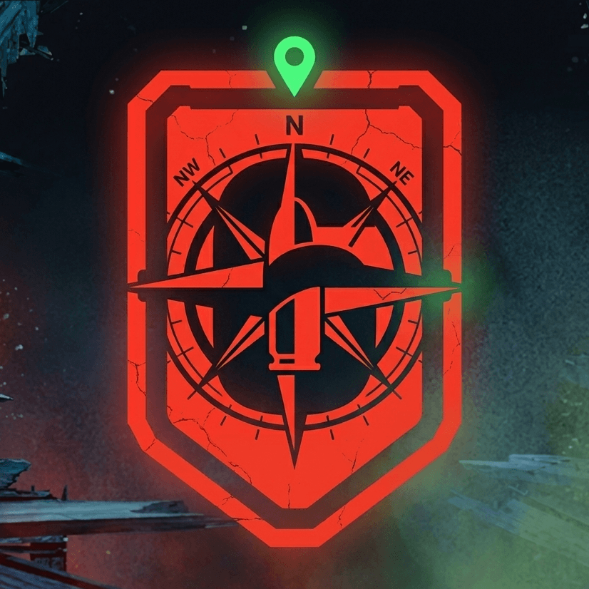
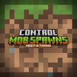

# Hey, I'm Heet 👋

UX/UI designer who also codes what he designs (React / Next.js). 
Master's in UX, completed as an apprentice · based in Toulouse, France · **open to a junior UX/UI designer role**.

## Projects

-  **[StreamGrid](https://heetstudio.fr/streamgrid/)**   Watch several Twitch streams at once, in a grid you can arrange however you like.
-  **[SteelSeries Compagnon](https://heetstudio.fr/steelseries-compagnon)**   A Stream Deck plugin that controls SteelSeries Sonar, with each button showing Sonar's live state.
-  **[ZeGuessr](https://heetstudio.fr/zeguessr-discord)**   A guessing game Discord bot, powered by Supabase.
- **[Playnite Better RichPresence](https://github.com/HeetroNoft/Playnite-Better-RichPresence)**   A Playnite extension that replaces the built-in Discord Rich Presence.
- **[Claude Mods](https://github.com/HeetroNoft/claude-mods)**   Claude Code mods: a pixel-art office where each session works at its own desk, and a cockpit band that shows each turn's plan and progress.

## Minecraft mods

Fabric mods I build and maintain, mostly to make my friends' modpacks play nice together.

-  **[Control Mob Spawns](https://github.com/HeetroNoft/Control-Mob-Spawns)**     Ban mobs and tweak spawn rates, caps and despawning from a clean in-game menu.
-  **[Handicap Voice Compat](https://github.com/HeetroNoft/Handicap-Voice-Compat)**     Makes Handicap's mute and deafness effects actually apply in Simple Voice Chat.
-  **[E4mc Voice Compat](https://github.com/HeetroNoft/E4mc-Voice-Compat)**     Gets Simple Voice Chat working for players who join through e4mc.
-  **[Infernal Mobs (Fabric)](https://github.com/HeetroNoft/InfernalMobs-Fabric)**     Fabric port of AtomicStryker's mod: Diablo-style elite mobs with loot.
- **[Custom Mob Attributes](https://github.com/HeetroNoft/Custom-Mob-Attributes)**     Fork of Fneifnox's mob stats mod, where I added random value ranges so each mob spawns with its own stats.

## Design

- **[The streamer: a designer's assistant in disguise](https://heetstudio.fr/livreblanc)**   White paper (in French) based on research with 16 streamers.

**[See my portfolio →](https://heetstudio.fr)**
